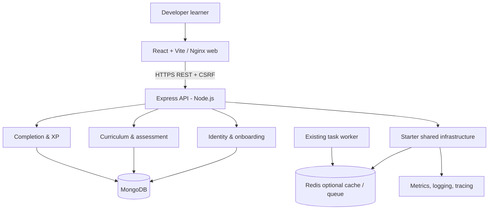
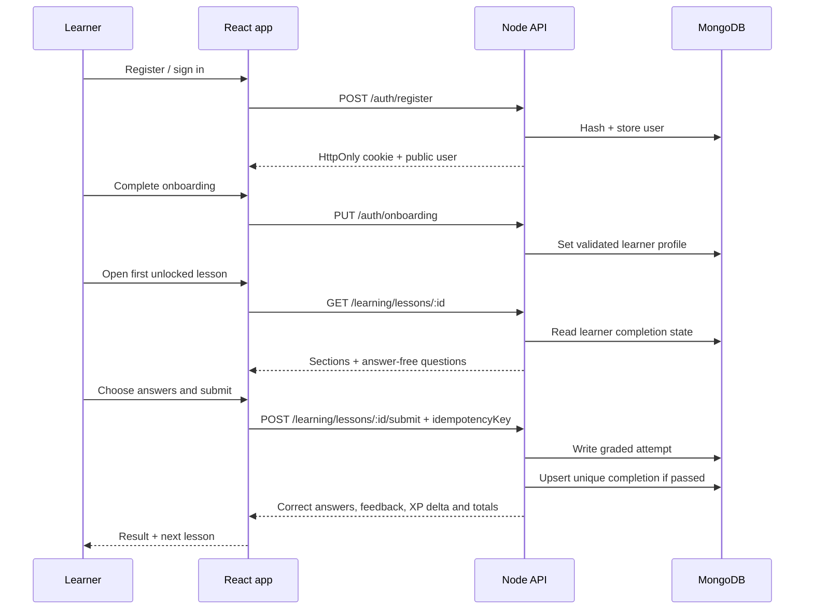
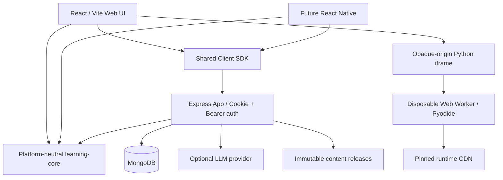

# HLD — AI Quest modular monolith

## Deployment topology

## Decisions

- **React + TypeScript** is the public web app. Routing is handled by React Router; server state by TanStack Query.
- **Express 5 + TypeScript** is the application backend. We intentionally replace the previous Django proposal with the user-provided Node-based starter.
- **MongoDB** is preserved rather than introducing a new database migration at MVP stage. Shared Zod contracts validate API boundaries.
- **Modular monolith:** modules grouped by domain and deployed together. The learning curriculum lives in a small versioned code catalog; learner state lives in MongoDB.
- **No arbitrary code execution or model service** in this milestone; it would require a separate isolation boundary with quotas, filesystem controls and no network by default.
- **Authenticated API:** signed HttpOnly session cookie, CSRF on mutations, restrictive CORS and per-request identity. `principal.id` governs progression data access.

## Major components

| Module | Responsibility | State |
|---|---|---|
| `modules/users` | Identity, profile and onboarding | MongoDB `User` |
| `modules/learning/catalog.ts` | Immutable curated content and answer key | Code (v1) |
| `modules/learning/learning.logic.ts` | Pure grading, unlock, streak, XP projection | Pure functions |
| `modules/learning/learning.service.ts` | Learner-specific progress, submission, completion | MongoDB |
| `modules/learning/learning.routes.ts` | REST interface with required authentication | Express |
| `apps/web/src/features/learning` | Path cards, detailed path, lesson/quiz player | React + React Query |
| `apps/web/src/features/progress` | Mastery, XP, badges | React |
| `apps/web/src/features/onboarding` | Audience/goals targeting | React |

## Primary flow

## Scaling considerations

- API remains stateless between requests; horizontally scale with shared MongoDB and secret management.
- Content is static within an API build, so **content edits currently require deployment**; P1 moves this to editorial-controlled versioning and publishing.
- Completion calculation queries a learner's records (9 at MVP); for a much larger catalog, use indexed aggregation and read models.
- `totalXp` is a projection of unique completion records and has no mutable counter that can race.
- Once code execution exists, isolate it in a separate locked-down service. Do not use background queue workers as code sandboxes.

## Non-functional requirements and assumptions

Target 99.5% availability at MVP (not measured). Set appropriate read/poll SLAs after load tests. Sensitive learner data should be minimized; no analytics from third parties is required to render the core experience. Keep policies for data retention, deletion, audit and minors in scope for production. Data is currently hosted per your MongoDB deployment, not a managed first-party learning cloud.

## Inherited versus added

This project **retains** starter observability, deployment, resilience, legacy task and audit modules as scaffolding; only the identity expansion and learning modules were changed/added in this milestone. Helm/Terraform charts are provided by the starter and have **not** been validated specifically for AI Quest production deployment.

---

# P1 architecture addendum — portability and feature services

Authoritative grading, publishing and XP are server-only. `learning-core` holds only algorithms, never canonical questions with answers; `client-sdk` injects fetch so cookies/CSRF can work on web and bearer tokens on React Native. API feature modules: `content`, `reviews`, `tutor`, `labs`, `portfolio`, `privacy`, and `users/native-auth`. MongoDB stores content drafts/releases, review state/events, tutor quota/events, capstones and refresh-token digests.

The optional LLM provider is a server-side adapter with timeouts, response-size limits and quotas. When the provider is not configured or unavailable, tutor hints fall back to curriculum text. Hosted model comparison is unavailable without explicit two-model configuration rather than returning fake LLM outputs.

Operational caveat: opaque-origin sandboxing and a capped browser worker are a defensive first layer, **not a substitute for adversarial browser sandbox testing**. Production requires encrypted backups, an observed recovery-time objective, controlled content staff onboarding, and stronger rate/abuse monitoring.

## Commerce domain (Cashfree PG)

React or React Native -> portable `@aiquest/client-sdk` -> authenticated Node.js Billing API -> Cashfree REST endpoints.
Cashfree web checkout is a web-only adapter. MongoDB stores `PaymentOrder` and `Entitlement`; product price and access rules are backend-owned. A dedicated **raw-body** webhook endpoint verifies signed Cashfree messages and independently fetches provider order state before granting an entitlement. The GenAI premium access guard is shared across lesson reads, graded submissions and tutor hints. See `docs/CASHFREE-PAYMENTS.md` for reconciliation and release requirements.
