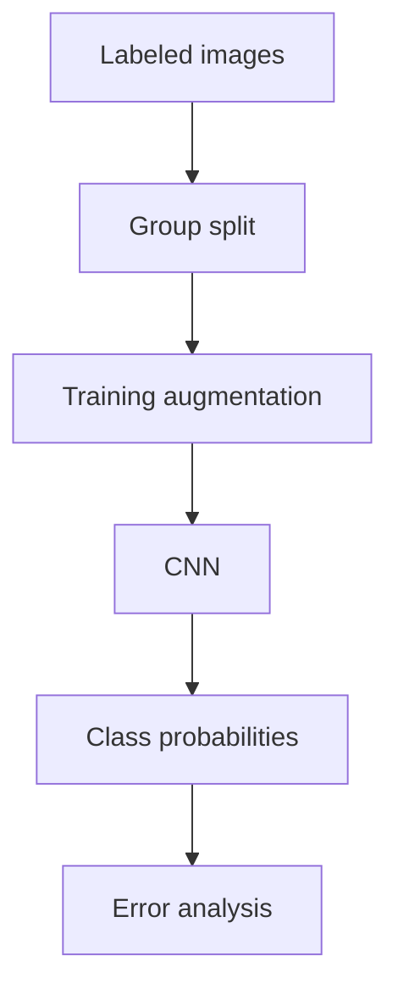

# C02: Image classification and datasets

## Module map

## Lessons
- [Image datasets, augmentation and labeling](C02-L01.md) — intermediate
- [Image classification and pretrained CNNs](C02-L02.md) — intermediate

Complete each exercise and demonstrate the related module examples.
