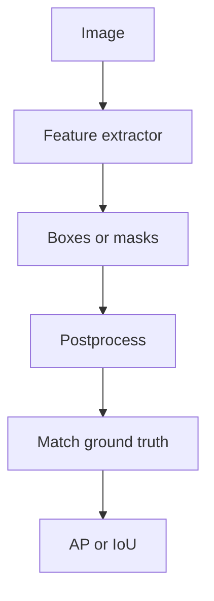

# C03: Detection and segmentation

## Module map

## Lessons
- [Object detection: boxes, IoU, NMS and mAP](C03-L01.md) — intermediate
- [YOLO, Faster R-CNN, DETR and detection training](C03-L02.md) — advanced
- [Semantic, instance and panoptic segmentation](C03-L03.md) — intermediate
- [U-Net, Mask R-CNN, SAM and foundation vision models](C03-L04.md) — advanced

Complete each exercise and demonstrate the related module examples.

## Extended study guide
[ Detection and segmentation metric walkthrough ](../../../guides/C03-deep-dive.md)
