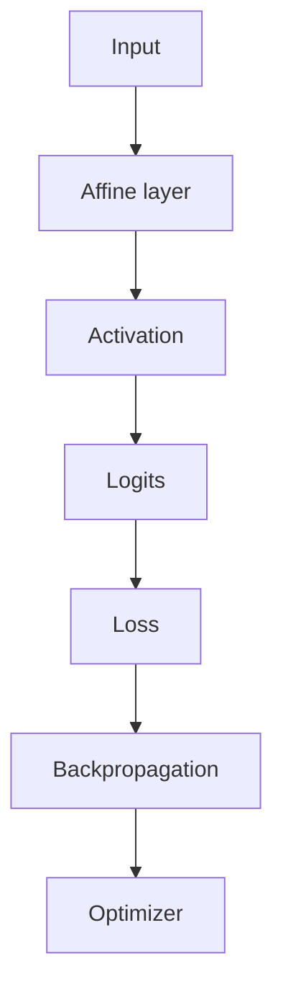

# D01: Neural network fundamentals

## Module map

## Lessons
- [Tensors, autograd and PyTorch fundamentals](D01-L01.md) — beginner
- [Perceptrons, MLPs and activation functions](D01-L02.md) — beginner
- [Forward pass, backpropagation and loss functions](D01-L03.md) — intermediate
- [Optimizers, initialization and learning-rate schedules](D01-L04.md) — intermediate

Complete each exercise and demonstrate the related module examples.
