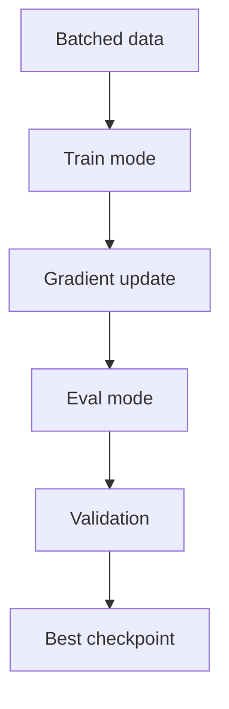

# D02: Deep learning training engineering

## Module map

## Lessons
- [Datasets, DataLoaders and training loops](D02-L01.md) — intermediate
- [Normalization, dropout and early stopping](D02-L02.md) — intermediate
- [Mixed precision, GPUs and distributed training](D02-L03.md) — advanced

Complete each exercise and demonstrate the related module examples.
