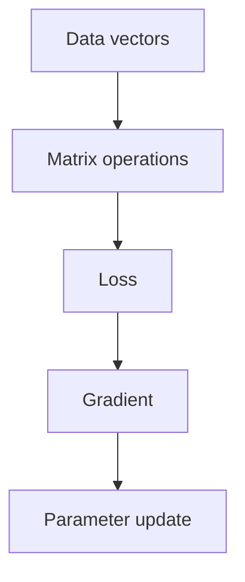

# F02: Mathematics for AI

## Module map

## Lessons
- [Linear algebra: vectors, matrices and dot products](F02-L01.md) — beginner
- [Eigenvalues, SVD and projections](F02-L02.md) — intermediate
- [Probability, distributions and Bayes rule](F02-L03.md) — beginner
- [Statistics, sampling and confidence intervals](F02-L04.md) — intermediate
- [Calculus, gradients and optimization](F02-L05.md) — intermediate
- [Information theory and numerical stability](F02-L06.md) — intermediate

Complete each exercise and demonstrate the related module examples.
