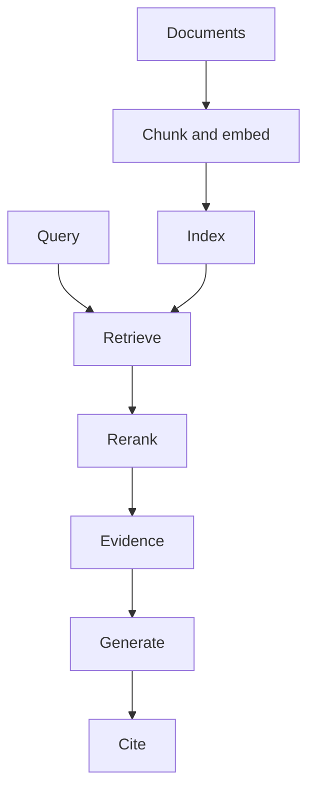

# G03: RAG foundations

## Module map

## Lessons
- [Embeddings, similarity and vector databases](G03-L01.md) — beginner
- [RAG ingestion, chunking and indexing](G03-L02.md) — intermediate
- [RAG retrieval, reranking and answer grounding](G03-L03.md) — intermediate
- [RAG evaluation and retrieval diagnostics](G03-L04.md) — intermediate

Complete each exercise and demonstrate the related module examples.
