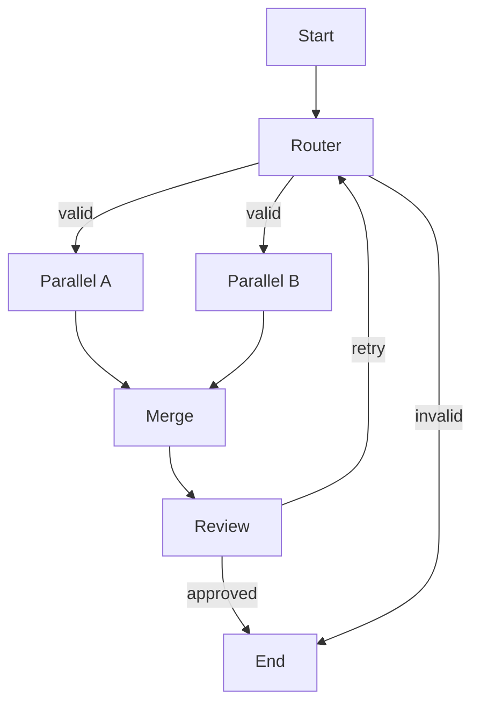

# G06: LangChain and LangGraph orchestration

## Module map

## Lessons
- [LangChain components and integration boundaries](G06-L01.md) — intermediate
- [LangGraph state, nodes, edges and sequential workflow](G06-L02.md) — intermediate
- [LangGraph conditional and parallel workflows](G06-L03.md) — intermediate
- [LangGraph iterative workflows, checkpointing and HITL](G06-L04.md) — advanced

Complete each exercise and demonstrate the related module examples.

## Extended study guide
[ Workflow patterns and state contracts ](../../../guides/G06-deep-dive.md)
