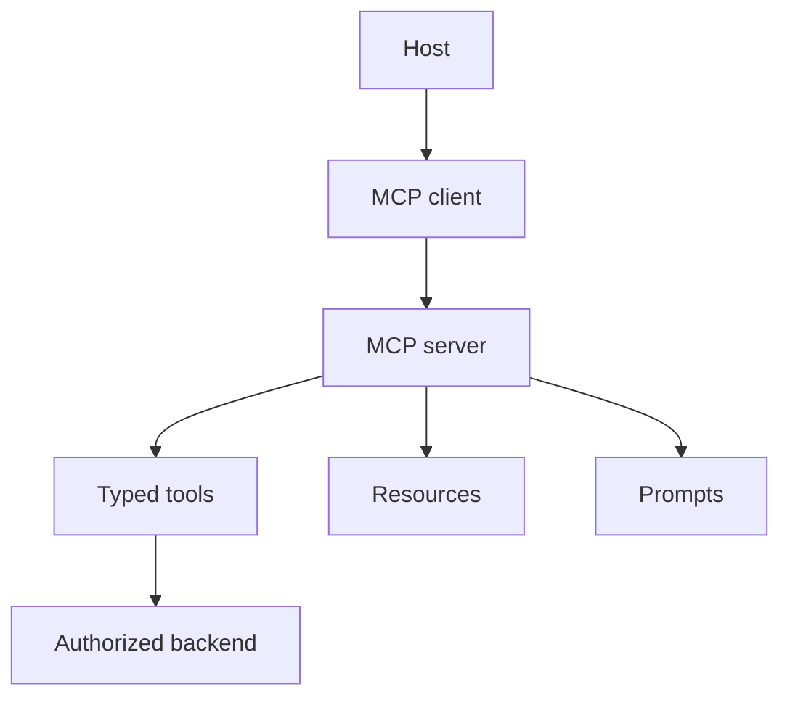

# G07: MCP and FastMCP

## Module map

## Lessons
- [Model Context Protocol (MCP) fundamentals](G07-L01.md) — intermediate
- [FastMCP server and client development](G07-L02.md) — intermediate
- [MCP security, remote deployment and interoperability](G07-L03.md) — advanced

Complete each exercise and demonstrate the related module examples.
