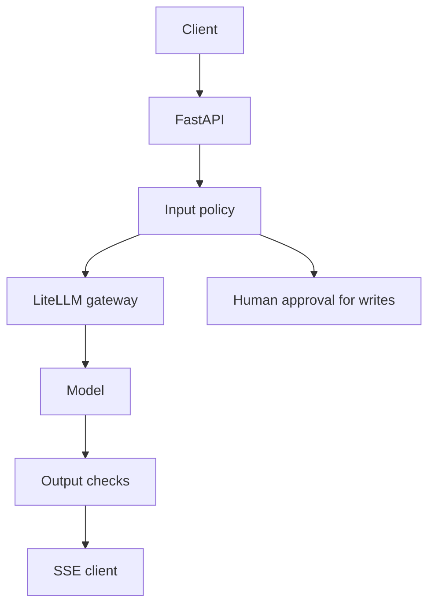

# G09: LLM APIs, gateways and guardrails

## Module map

## Lessons
- [FastAPI, Pydantic and async inference APIs](G09-L01.md) — intermediate
- [Streaming responses: SSE, chunks and cancellation](G09-L02.md) — intermediate
- [LiteLLM gateway, routing and fallback](G09-L03.md) — intermediate
- [Guardrails, prompt injection, privacy and HITL](G09-L04.md) — advanced

Complete each exercise and demonstrate the related module examples.
