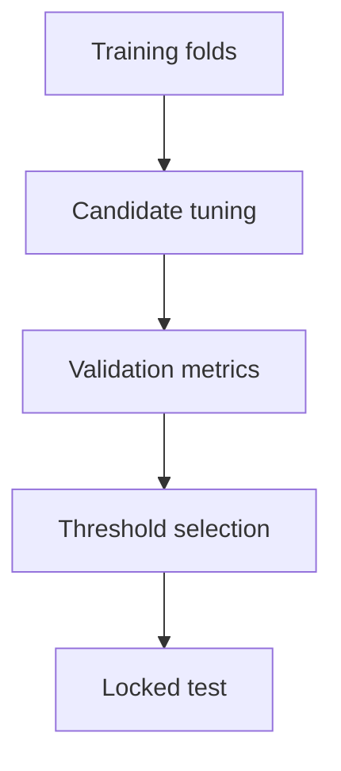

# M03: Evaluation and reliable model selection

## Module map

## Lessons
- [Classification, regression and ranking metrics](M03-L01.md) — intermediate
- [Cross-validation and hyperparameter search](M03-L02.md) — intermediate
- [Imbalanced learning, calibration and uncertainty](M03-L03.md) — advanced
- [Interpretability, fairness and error analysis](M03-L04.md) — advanced

Complete each exercise and demonstrate the related module examples.
