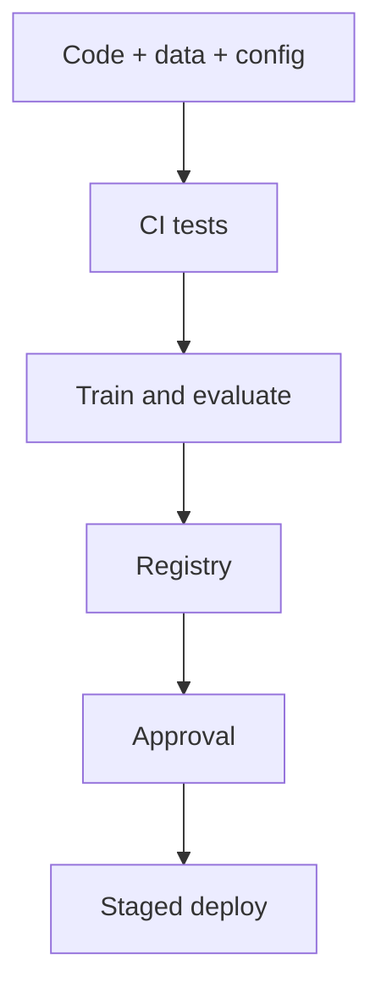

# P01: MLOps and delivery engineering

## Module map

## Lessons
- [Model packaging, APIs and Docker](P01-L01.md) — intermediate
- [MLflow, data versioning and experiment tracking](P01-L02.md) — intermediate
- [CI/CD, continuous training and DevSecOps](P01-L03.md) — advanced

Complete each exercise and demonstrate the related module examples.
