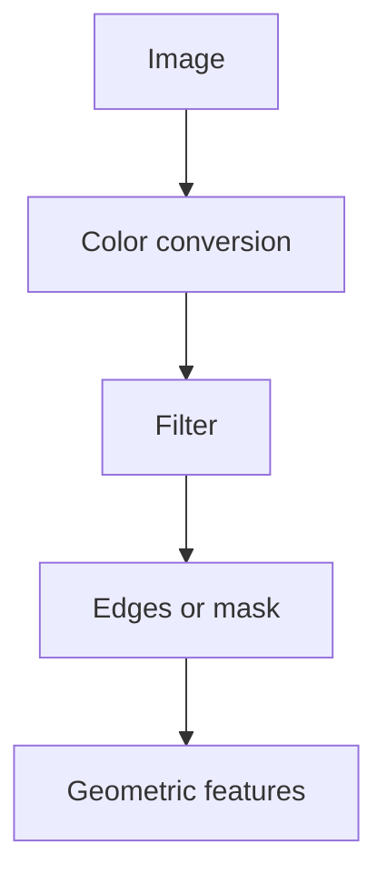

# C01: Classical computer vision

## Module map

## Lessons

- [Image representation, color spaces and OpenCV](C01-L01.md) — beginner
- [Filtering, edges and morphology](C01-L02.md) — beginner
- [Geometric transforms, calibration and features](C01-L03.md) — intermediate

Complete each exercise and demonstrate the related module examples.
