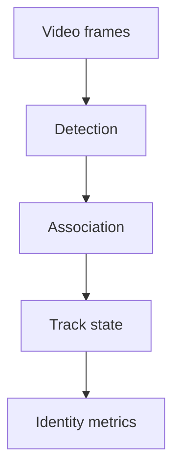

# C04: Advanced vision and multimodal perception

## Module map

## Lessons

- [Video, optical flow and object tracking](C04-L01.md) — intermediate
- [Vision transformers, CLIP and multimodal vision](C04-L02.md) — advanced
- [OCR, document AI, 3D and deployment](C04-L03.md) — advanced

Complete each exercise and demonstrate the related module examples.
