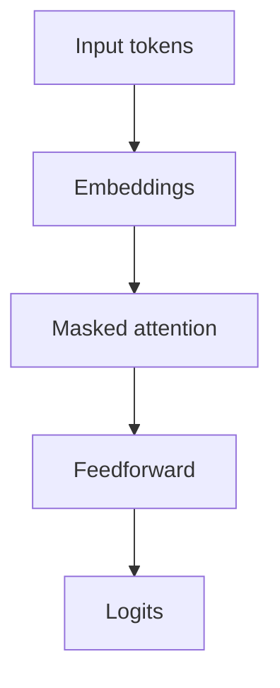

# D03: Neural architectures and transformers

## Module map

## Lessons

- [CNN foundations and receptive fields](D03-L01.md) — intermediate
- [RNNs, LSTMs, GRUs and sequence modeling](D03-L02.md) — intermediate
- [Attention and transformers](D03-L03.md) — intermediate
- [Encoder, decoder and encoder-decoder architectures](D03-L04.md) — advanced

Complete each exercise and demonstrate the related module examples.

## Extended study guide

[ Neural tensor shapes and attention worked example ](../../../guides/D03-deep-dive.md)
