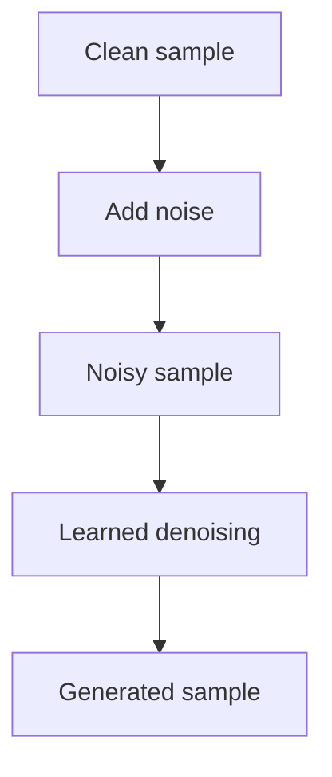

# D04: Advanced learning and generative models

## Module map

## Lessons

- [Transfer learning, embeddings and self-supervised learning](D04-L01.md) — intermediate
- [Autoencoders, VAEs and GANs](D04-L02.md) — advanced
- [Diffusion and score-based generative models](D04-L03.md) — advanced
- [Reinforcement learning and preference optimization](D04-L04.md) — advanced

Complete each exercise and demonstrate the related module examples.
