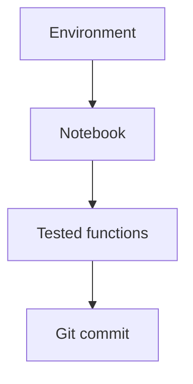

# F01: Python and developer tooling

## Module map

## Lessons

- [Python environments and notebooks](F01-L01.md) — beginner
- [Python data types, control flow and functions](F01-L02.md) — beginner
- [NumPy arrays, broadcasting and vectorization](F01-L03.md) — beginner
- [Pandas, data cleaning and EDA](F01-L04.md) — beginner
- [Git, testing and reproducible experiments](F01-L05.md) — intermediate

Complete each exercise and demonstrate the related module examples.
