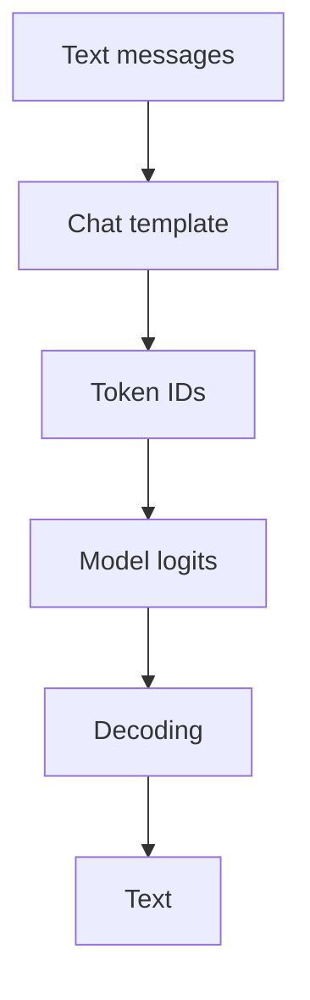

# G01: LLM foundations and Hugging Face

## Module map

## Lessons

- [Generative AI landscape and LLM fundamentals](G01-L01.md) — beginner
- [Tokens, tokenizers and context windows](G01-L02.md) — beginner
- [Decoding, sampling and inference constraints](G01-L03.md) — intermediate
- [Hugging Face Hub, Transformers and model selection](G01-L04.md) — intermediate

Complete each exercise and demonstrate the related module examples.
