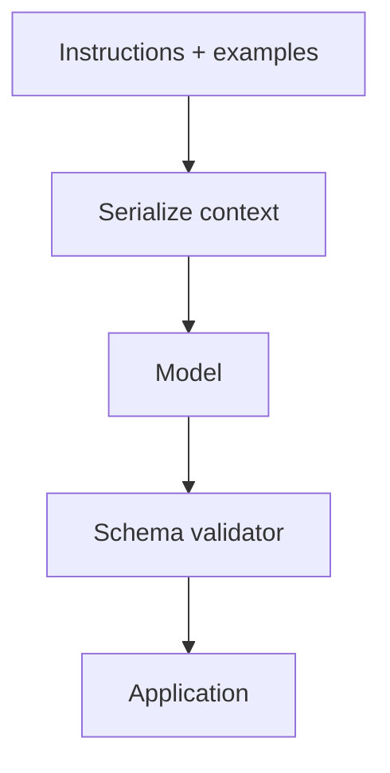

# G02: Prompt and context engineering

## Module map

## Lessons

- [Zero-shot, one-shot and few-shot prompting](G02-L01.md) — beginner
- [Structured output, few-shot schemas and Pydantic](G02-L02.md) — intermediate
- [Persona prompting, reasoning prompts and prompt injection](G02-L03.md) — intermediate
- [Prompt serialization: ChatML, Alpaca and INST](G02-L04.md) — intermediate
- [Prompt versioning, testing and context engineering](G02-L05.md) — advanced

Complete each exercise and demonstrate the related module examples.

## Extended study guide

[ Prompt engineering pattern library ](../../../guides/G02-deep-dive.md)
