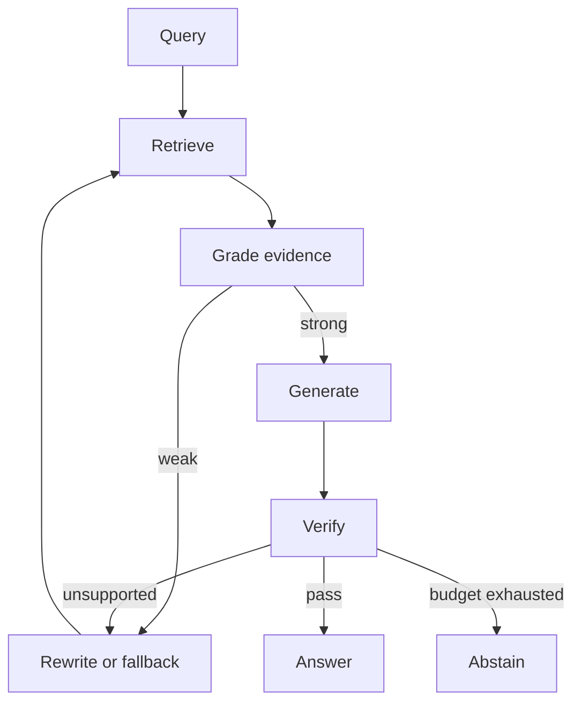

# G04: Advanced RAG patterns

## Module map

## Lessons

- [Self-reflective RAG and Self-RAG](G04-L01.md) — advanced
- [Corrective RAG (CRAG)](G04-L02.md) — advanced
- [Self-corrective RAG and iterative verification](G04-L03.md) — advanced
- [Agentic RAG and routing](G04-L04.md) — advanced

Complete each exercise and demonstrate the related module examples.

## Extended study guide

[ RAG pattern comparison and worked trace ](../../../guides/G04-deep-dive.md)
