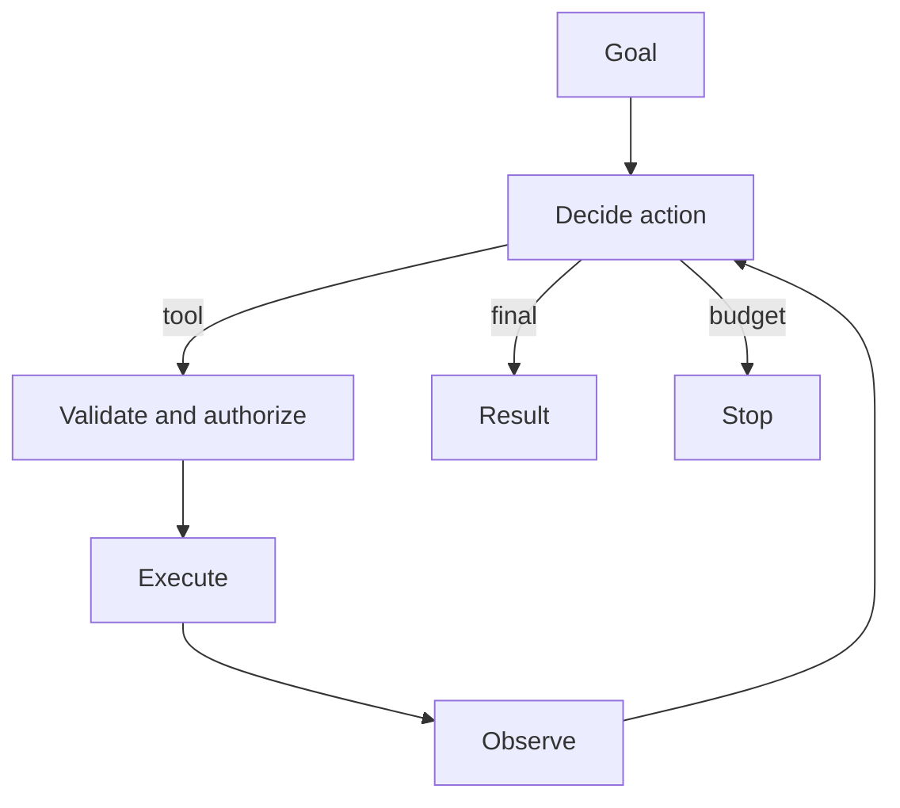

# G05: Agent design patterns

## Module map

## Lessons

- [Tool calling and tool-use agent pattern](G05-L01.md) — intermediate
- [ReAct, planning and action-observation loops](G05-L02.md) — intermediate
- [Reflection and evaluator-optimizer agents](G05-L03.md) — intermediate
- [Multi-agent systems and orchestration](G05-L04.md) — advanced

Complete each exercise and demonstrate the related module examples.
