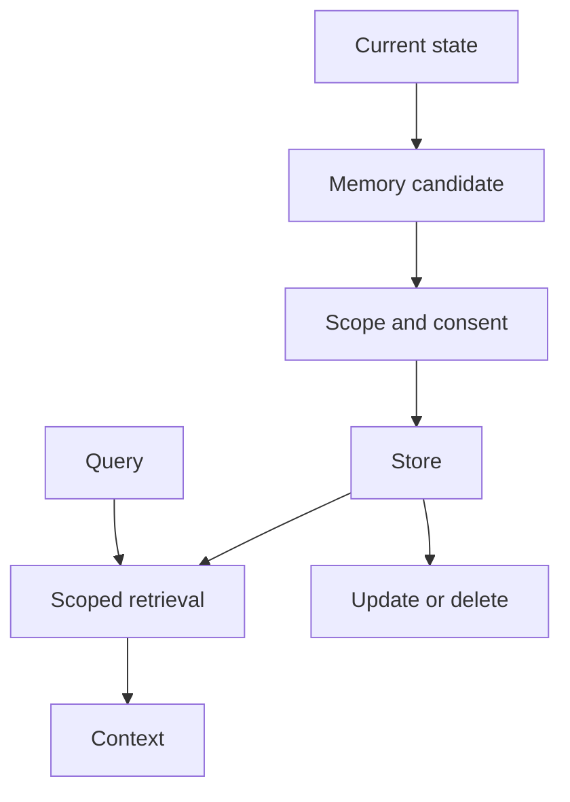

# G08: Agent memory and Mem0

## Module map

## Lessons

- [Memory taxonomy: working, factual, episodic and semantic](G08-L01.md) — intermediate
- [Memory retrieval, summarization and vector storage](G08-L02.md) — intermediate
- [Mem0 and persistent agent memory](G08-L03.md) — advanced

Complete each exercise and demonstrate the related module examples.
