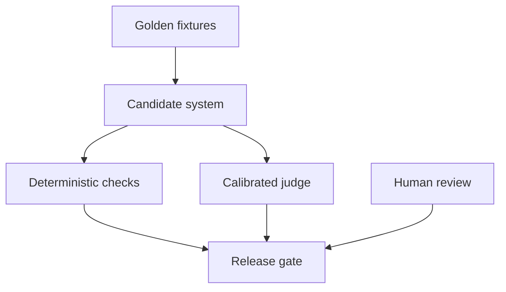

# G10: LLM and agent evaluation

## Module map

## Lessons

- [Agent evaluation, datasets and LLM-as-judge](G10-L01.md) — intermediate
- [DeepEval for LLM and agent regression tests](G10-L02.md) — intermediate
- [Ragas for RAG evaluation](G10-L03.md) — intermediate
- [Promptfoo for prompt/model evaluation and red teaming](G10-L04.md) — intermediate
- [Observability, traces, evaluation gates and cost](G10-L05.md) — advanced

Complete each exercise and demonstrate the related module examples.

## Extended study guide

[ Evaluation design and release gates ](../../../guides/G10-deep-dive.md)
