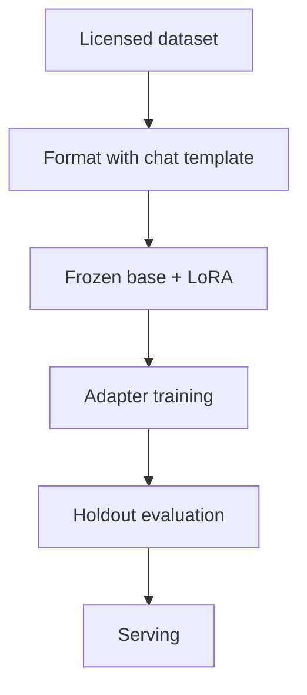

# G11: LLM adaptation and multimodal AI

## Module map

## Lessons

- [Fine-tuning datasets, SFT and PEFT/LoRA](G11-L01.md) — intermediate
- [QLoRA, quantization, serving and model optimization](G11-L02.md) — advanced
- [Multimodal LLMs, diffusion apps and fine-tuning decisions](G11-L03.md) — advanced

Complete each exercise and demonstrate the related module examples.
