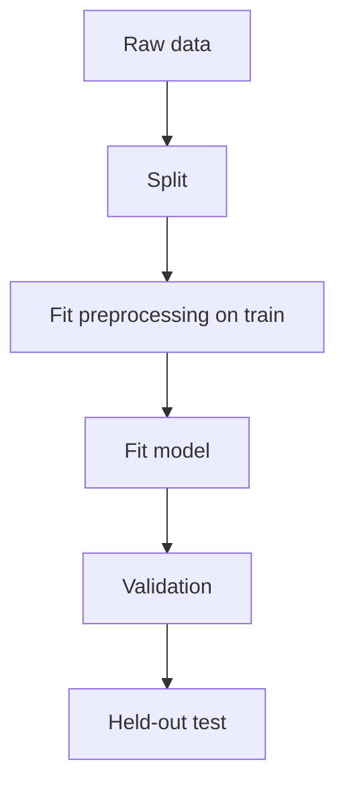

# M01: ML lifecycle and data preparation

## Module map

## Lessons

- [ML problem framing and baselines](M01-L01.md) — beginner
- [Train, validation, test and leakage](M01-L02.md) — beginner
- [Preprocessing and feature pipelines](M01-L03.md) — intermediate

Complete each exercise and demonstrate the related module examples.
