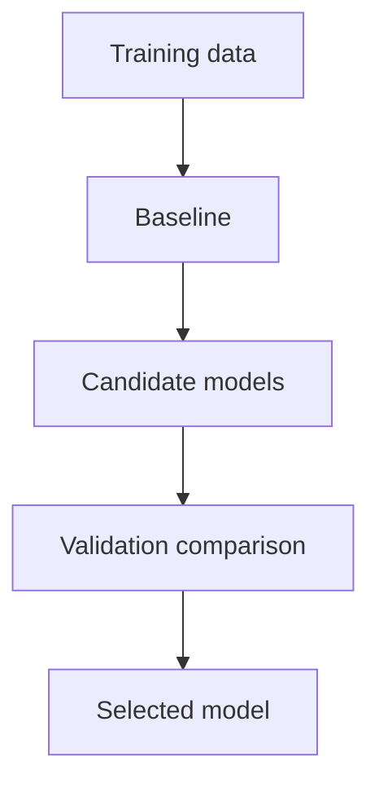

# M02: Supervised learning algorithms

## Module map

## Lessons

- [Linear and polynomial regression](M02-L01.md) — beginner
- [Logistic regression and classification thresholds](M02-L02.md) — beginner
- [k-nearest neighbors, naive Bayes and SVM](M02-L03.md) — intermediate
- [Decision trees and random forests](M02-L04.md) — intermediate
- [Gradient boosting: XGBoost, LightGBM and CatBoost](M02-L05.md) — intermediate
- [Regularization, feature selection and bias-variance](M02-L06.md) — intermediate

Complete each exercise and demonstrate the related module examples.

## Extended study guide

[ ML algorithm selection and formulas ](../../../guides/M02-deep-dive.md)
