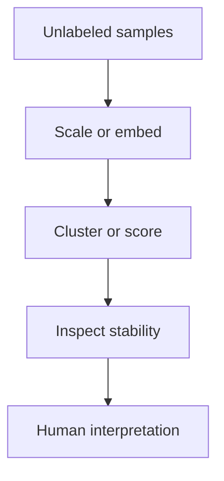

# M04: Unsupervised learning

## Module map

## Lessons

- [Clustering: k-means, hierarchical and DBSCAN](M04-L01.md) — intermediate
- [Dimensionality reduction: PCA, t-SNE and UMAP](M04-L02.md) — intermediate
- [Anomaly detection and novelty detection](M04-L03.md) — intermediate

Complete each exercise and demonstrate the related module examples.
