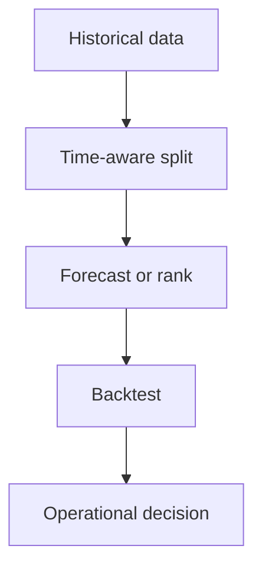

# M05: Applied ML and experimentation

## Module map

## Lessons

- [Time series, forecasting and backtesting](M05-L01.md) — intermediate
- [Recommendation and learning to rank](M05-L02.md) — intermediate
- [Causal inference and experimentation](M05-L03.md) — advanced

Complete each exercise and demonstrate the related module examples.
