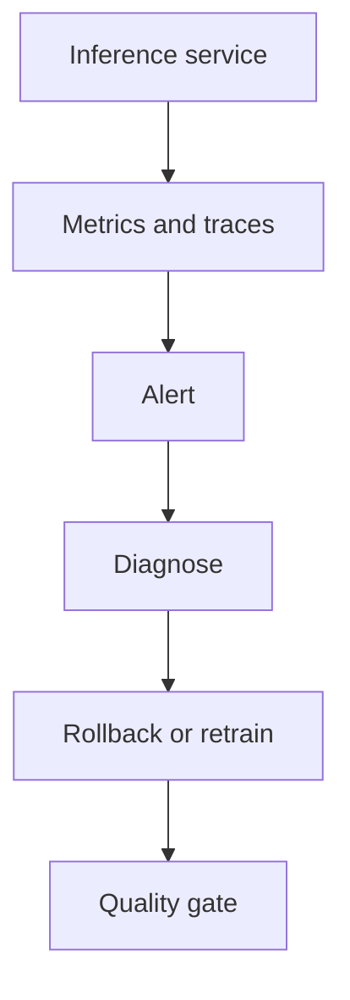

# P02: Production reliability and responsible AI

## Module map

## Lessons

- [Monitoring, drift, reliability and retraining](P02-L01.md) — advanced
- [Responsible AI, governance and security](P02-L02.md) — advanced
- [Cloud architecture, scaling and deployment trade-offs](P02-L03.md) — advanced

Complete each exercise and demonstrate the related module examples.
